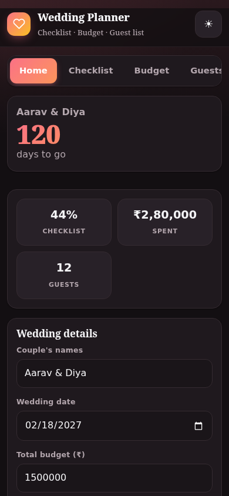
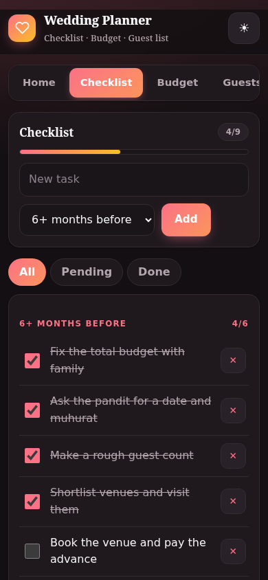
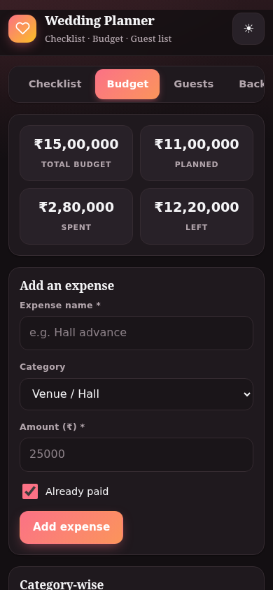
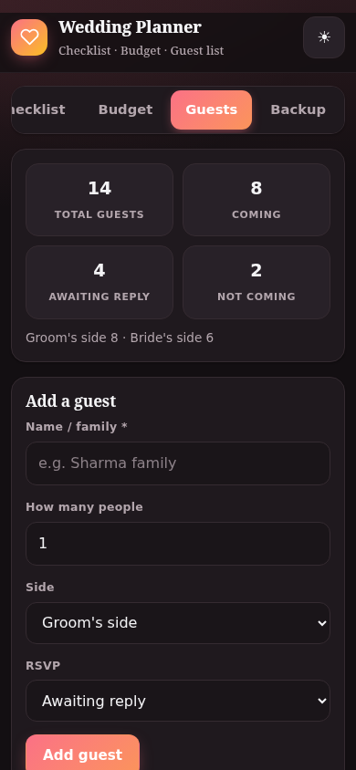
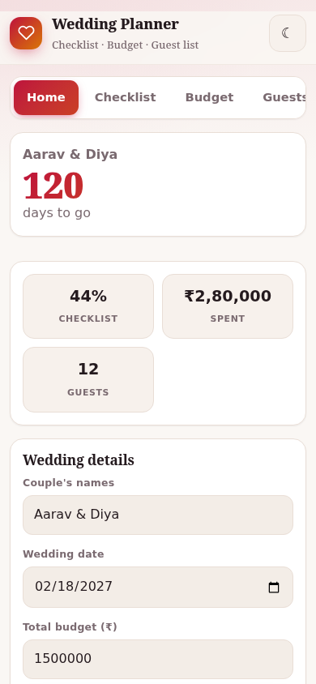
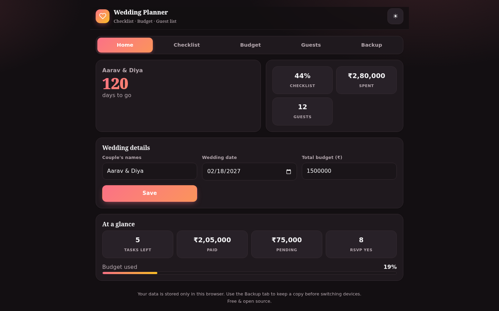

# Wedding Checklist + Budget Planner

A complete planner for Indian weddings: a month-by-month checklist, a budget tracker in rupees, and a guest list with RSVP tracking.

**Live app:** https://akash991833.github.io/wedding-checklist-budget-app/

Free, no sign-up, no ads. Works in the browser, offline after the first visit, and can be installed on your phone. Everything is saved on your device only.

## Features

- Countdown to the wedding day on the home screen
- 40+ task checklist organised by timeline (6+ months before to the wedding day), with custom tasks and filters
- Budget tracker: total budget, category-wise plan vs actual, paid/pending status, over-budget warnings
- Guest list: family/group entries, headcount, groom's side / bride's side, RSVP status with filters
- Export: JSON backup and restore, expenses / guests / checklist as CSV (opens in Excel), print
- Dark and light mode, works offline, installable on phone

## How to use

1. On Home, set the couple's names, wedding date and total budget.
2. Tick tasks in Checklist as you finish them; add your own.
3. Record every payment in Budget and set a plan per category.
4. Track invitations and RSVPs in Guests.
5. Use Backup regularly - the data lives only in this browser.

## Screenshots









## Good to know (limits)

- Data is stored only in your browser (localStorage). Use Backup to move it to another device.
- Amounts are in Indian rupees (₹) with Indian digit grouping.
- The default checklist is a general Indian-wedding template; add or remove tasks to fit your ceremony.

## Run it yourself

No build step. Clone the repo and open `index.html`, or serve the folder with any static server:

```bash
git clone https://github.com/AKASH991833/wedding-checklist-budget-app.git
cd wedding-checklist-budget-app
python3 -m http.server 8080
```

Plain HTML, CSS and JavaScript. No tracking, no external requests.

## Privacy

No account, no server, no analytics. Data stays in your browser's local storage. Clearing browser data deletes it, so use the Backup option if it matters.

## License

MIT
